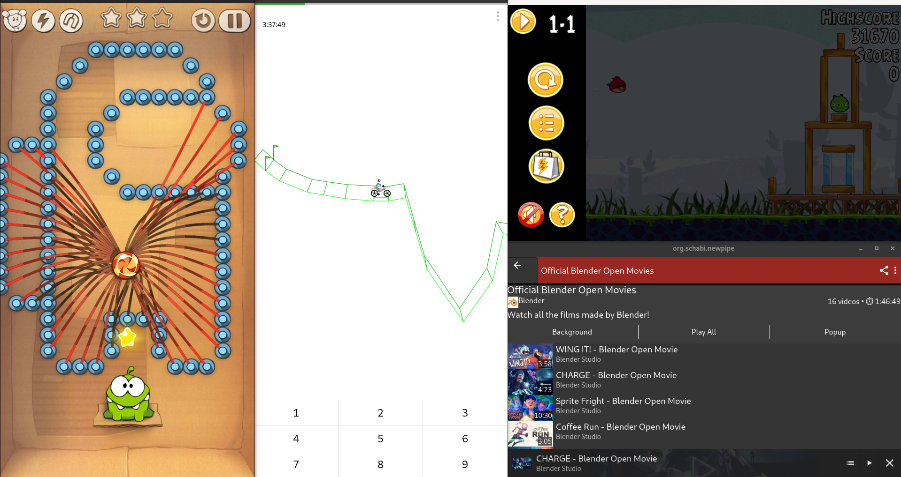
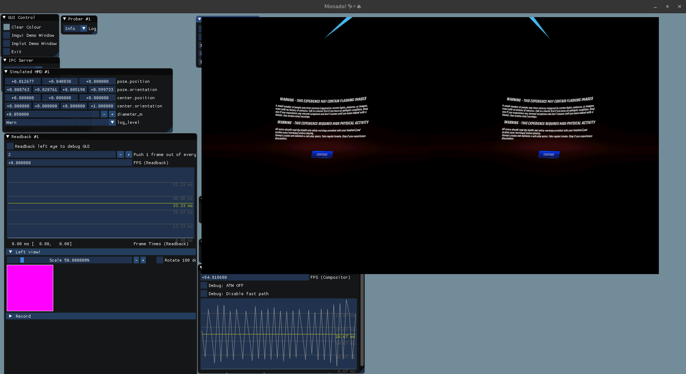

<p align="center">
  
</p>

# Android Translation Layer (ATL)

> **Note**: This repository is an **unofficial development workspace** based on the upstream [Android Translation Layer (ATL)](https://gitlab.com/android_translation_layer/android_translation_layer). It includes extended widget rendering (dynamic text layout, gravity, styling), Conscrypt SSL/TLS provider integration, Activity lifecycle fixes, and expanded Bionic translation.

A lightweight translation layer that allows running Android apps natively on a Linux desktop—without virtual machines, emulation containers, or a full AOSP rootfs.

<p align="center">
  
  <br/>
  <em>Angry Birds 3.2.0, Worms 2 Armageddon, and Gravity Defied running side by side on Linux desktop</em>
</p>

<p align="center">
  
  <br/>
  <em>Oculus Quest version of BeatSaber running on an aarch64 laptop</em>
</p>

---

## Why ATL?

Unlike container-based solutions (e.g. Waydroid) which boot an entire Android OS userland (`system_server`, `SurfaceFlinger`, HALs, and Android daemons inside a container), **ATL** acts like Wine or Proton for Android:

* **Near-Zero Overhead:** Runs directly as a native host Linux process using glibc/musl without the CPU and RAM overhead of a containerized OS.
* **Native GTK4 Integration:** Android `View` hierarchies (`TextView`, `EditText`, `Button`, `ImageView`, `ScrollView`, etc.) map directly to native desktop GTK4 widgets.
* **Embedded ART:** Boots the Android Runtime directly in-process for instant startup.
* **Bionic Translation:** Built-in dynamic linker executes Android Bionic-linked `.so` libraries directly on standard desktop Linux.

---

## Quick Start

### 1. Build
```sh
meson setup builddir
ninja -C builddir
```
*(For distribution-specific dependencies and setup, see the [Build Guide](doc/Build.md).)*

### 2. Run an App
```sh
RUN_FROM_BUILDDIR=1 ./builddir/android-translation-layer path/to/app.apk
```

---

## Documentation

To keep this overview clean, detailed documentation has been organized into dedicated guides:

| Document | Description |
| :--- | :--- |
| **[Usage Guide](doc/Usage.md)** | Running standard APKs, split APKs, launching specific activities, and desktop integration (`--install`). |
| **[Build Guide](doc/Build.md)** | Step-by-step compilation instructions for Arch, Ubuntu/Debian, Fedora, and Alpine. |
| **[Architecture](doc/Architecture.md)** | Deep-dive into execution flow, cut points, and [architecture diagrams](assets/android_translation_architecture.svg). |
| **[Environment Variables](doc/Envs.md)** | Reference for all runtime environment variables and debug options. |
| **[Troubleshooting](doc/Troubleshooting.md)** | Graphics settings (X11 EGL, Cairo fallback), Apple Silicon 16KB pages, and native bridges. |
| **[Contributing & Stubs](doc/QuickHelp.md)** | How to implement missing Android APIs and contribute stubs. |

---

## Upstream & Acknowledgements

* **Upstream Project:** [gitlab.com/android_translation_layer/android_translation_layer](https://gitlab.com/android_translation_layer/android_translation_layer)
* **Test APKs Repository:** [gitlab.com/android_translation_layer/atl_test_apks](https://gitlab.com/android_translation_layer/atl_test_apks)
